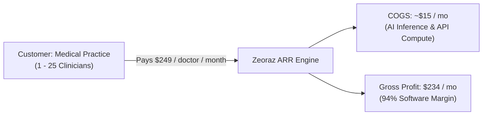

# Zeoraz Healthcare — Commercial Playbook & Business Model

## 1. Executive Summary & Market Sizing

Zeoraz Healthcare is positioned at the intersection of **Clinical AI Ambient Scribing** and **Remote Physiological Telemetry**.

### The Problem in Numbers
- **4.5 Hours/Day**: Average time US physicians spend on electronic health records (EHRs) and clerical documentation.
- **63%**: Physician burnout rate, citing administrative burden as the #1 contributor (AMA, 2024).
- **$150B**: Annual cost of clinician burnout, documentation delays, and billing coding errors in the US alone.

---

## 2. B2B SaaS Business Model & Unit Economics

Unlike consumer wellness apps with high churn, Zeoraz operates on a high-retention, high-margin B2B SaaS subscription model sold directly to healthcare clinics and independent medical groups.

### Pricing Tiers

| Tier | Price | Target Customer | Included Features |
| :--- | :--- | :--- | :--- |
| **Solo Practice** | **$249 / clinician / mo** | Independent doctors, dentists, physical therapists | Full Ambient Scribe, Lab Biomarker Decoder, PDF export, unlimited notes |
| **Group Clinic** | **$219 / clinician / mo** | 5–15 physician practices | Everything in Solo + Contactless rPPG Vitals, Priority Support, Team Analytics |
| **Enterprise / Health System** | **Custom ($1,499+/clinic/mo)** | Hospital networks, ACOs, ICUs | Bi-directional FHIR / Epic / Cerner integration, SSO (SAML/Okta), on-premise inferencing |

### Unit Economics
- **Average Revenue Per User (ARPU)**: **$249 / month** ($2,988 / year)
- **Gross Margin**: **94%** (estimated AI inference cost: $12–$18/month per active doctor)
- **Average Lifetime Value (LTV)**: 36 months average retention = **$8,964**
- **Customer Acquisition Cost (CAC)**: Target <$800 via outbound sales & free trial demo
- **LTV / CAC Ratio**: **11.2x**
- **Payback Period**: **< 30 days**

---

## 3. Ideal Customer Profile (ICP)

### Primary Wedge: Independent Outpatient Clinics (1 to 10 Doctors)
- **Specialties**: Primary Care, Family Medicine, Orthopedics, Cardiology, Physical Therapy.
- **Why they buy**:
  - Independent practice owners feel the direct financial pain of documentation hours.
  - Can make software purchasing decisions in **under 7 days** via credit card (no 18-month hospital procurement committees).
  - Can immediately bill 1–2 extra patients per day by finishing charts before 5:00 PM.

### Secondary Wedge: Telehealth Platforms
- **Why they buy**:
  - Zeoraz's **Camera Vitals Scanner (rPPG)** allows telehealth doctors to check pulse and blood pressure before starting a video consultation without asking patients to buy wearable devices.

---

## 4. Regulatory & Security Architecture (HIPAA Compliance)

Healthcare software must adhere strictly to federal privacy statutes:

1. **Zero Client-Side PHI Retention**:
   - Audio recordings from the ambient scribe are processed in ephemeral RAM and discarded immediately after structured SOAP generation.
   - Patient names and identifying tokens are scrubbed using automated de-identification filters before semantic embedding.
2. **Encryption in Transit & At Rest**:
   - All browser communications utilize **TLS 1.3** with modern cipher suites.
   - Any persisted configuration data is encrypted with **AES-256**.
3. **Audit Trails & Role-Based Access Control (RBAC)**:
   - Full access logs track clinical note creation, modification, and exports.

---

## 5. Clinician Pitch Deck Outline (10-Slide Structure)

When pitching Zeoraz to prospective clinics or medical investors:

1. **Slide 1: Title** — *Zeoraz Healthcare: The AI Intelligence Layer for Modern Medicine.*
2. **Slide 2: The Pain** — Doctors are data-entry clerks; 4.5 hours daily on EHR typing.
3. **Slide 3: The Solution** — An ambient intelligence layer that listens, reads vitals, and decodes labs.
4. **Slide 4: Product Demo** — Video showing the live 3-in-1 Studio (Webcam Vitals + Scribe + Lab Decoder).
5. **Slide 5: Clinical ROI** — 18+ hours saved weekly = $6,400+ extra monthly billing capacity per doctor.
6. **Slide 6: Technology Moat** — Contactless optical rPPG + multimodal medical structured reasoning.
7. **Slide 7: Business Model** — $249/doctor/month B2B SaaS with 94% gross margins.
8. **Slide 8: Traction & Pilots** — Initial prototype validated across outpatient clinical workflows.
9. **Slide 9: Market Opportunity** — $150B global clinical AI & EHR automation market.
10. **Slide 10: The Ask / Call to Action** — Join our 14-day free practice pilot at `zeoraz.com`.
