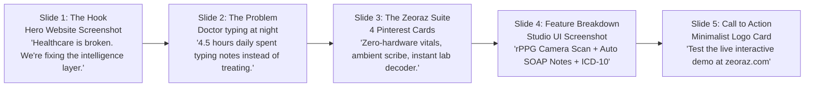

# Zeoraz Healthcare — Social Marketing & Reel Production Engine

## 1. Automated Reel Video Production Engine

Zeoraz includes an automated programmatic video generation script that compiles 4K editorial photography, procedural audio synthesis, neural voiceover, and kinetic typography into a production-ready **9:16 vertical 1080×1920 MP4 video**.

### Script Location & Architecture
- **Script File**: `scratch/generate_reel.py`
- **Output File**: `public/videos/zeoraz-instagram-reel.mp4`
- **Resolution**: 1080 × 1920 (9:16 Vertical Full HD)
- **Frame Rate**: 24.0 FPS (Cinematic standard)
- **Audio Codec**: AAC Stereo 44.1 kHz, mixed with neural voiceover + ambient synth pad

### How to Re-render or Customize the Reel
To generate a new video or update the narration:
```bash
# Execute the rendering script
python scratch/generate_reel.py
```
The script will:
1. Generate the neural voiceover using `edge-tts` (`en-US-ChristopherNeural` at `+8%` speech rate).
2. Synthesize an ambient multi-chord electronic pad in stereo at 44.1 kHz using `numpy` and `wave`.
3. Animate Ken Burns zoom transitions across all 4 Pinterest-aesthetic images.
4. Render animated kinetic typography, live pulse wave lines, and rising clinical bar charts on canvas.
5. Export a lightweight, high-bitrate MP4 (~9.6 MB) directly to `public/videos/`.

---

## 2. Instagram Carousel Launch Blueprint (5 Slides)

Carousels generate **3x more reach, saves, and comments** than single-image posts on Instagram.



---

## 3. High-Converting Captions

### Option A: The Founder Visionary Caption (Recommended)
```text
Doctors didn’t spend 12+ years in medical school to become data-entry clerks. 🩺

Right now, the average clinician spends 4.5 hours every single day typing into outdated computer screens. Meanwhile, patients leave appointments confused by their own lab results.

Today, we’re introducing @zeoraz: The AI Intelligence Layer for Modern Healthcare. ⚡️

Instead of clunky hospital paperwork, we built an ambient intelligence system that:
1️⃣ Decodes complex blood panels & biomarkers in 3 seconds.
2️⃣ Scans cardiovascular vitals directly through a smartphone camera (Zero hardware required).
3️⃣ Transcribes doctor-patient conversations into structured clinical SOAP notes automatically.

Healthcare doesn't need more paperwork. It needs intelligent, frictionless care.

👉 Experience our live interactive demo at the link in our bio.
💬 Drop a comment: What’s the most frustrating part of visiting the doctor today?

#HealthTech #ArtificialIntelligence #MedTech #DigitalHealth #AIHealthcare #Zeoraz #FutureOfMedicine #StartupLife #HealthInnovation #ClinicalAI
```

### Option B: Short & Punchy (For Reels & TikTok)
```text
What if your phone camera could read your pulse and vitals in 10 seconds? 👁️✨

No wearable watches. No chest straps. Zero physical sensors. 

At @zeoraz, we’re building the AI Intelligence Layer for modern medicine:
🫀 Contactless optical pulse & cardiovascular telemetry (rPPG)
🧪 Instant lab test decoder — turns complex blood panels into visual risk charts in 3 seconds
🩺 Ambient clinical consultation scribe — saves doctors 18+ hours of charting every week

🔗 Link in bio to test the live demo!

#Zeoraz #HealthTech #AI #MedicalAI #StartupLife #MedTech #Innovation
```

---

## 4. Growth Hacking Tactics for Health-Tech Startups

1. **LinkedIn Physician Direct Outreach**:
   - Send connection requests to local independent practice owners (Cardiologists, Primary Care, Orthopedic surgeons).
   - Message: *"Dr. [Name], we built a live tool that generates clinical SOAP notes and ICD-10 codes from ambient conversation, saving ~18 hours/week. You can test it live with your mic at zeoraz.com — would love your honest clinician feedback."*
2. **Interactive Calculator Virality**:
   - Post screen recordings of the **Practice ROI Calculator** on X and LinkedIn with the caption: *"How much billable capacity does your practice lose to EHR charting each month? Drag the sliders to see."*
3. **Medical Residency & Medical Student Forums**:
   - Share the free biomarker decoder tool on medical education subreddits (`r/medicine`, `r/medicalschool`) as an open-access clinical utility.
